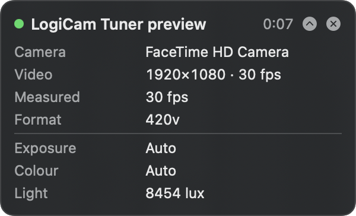
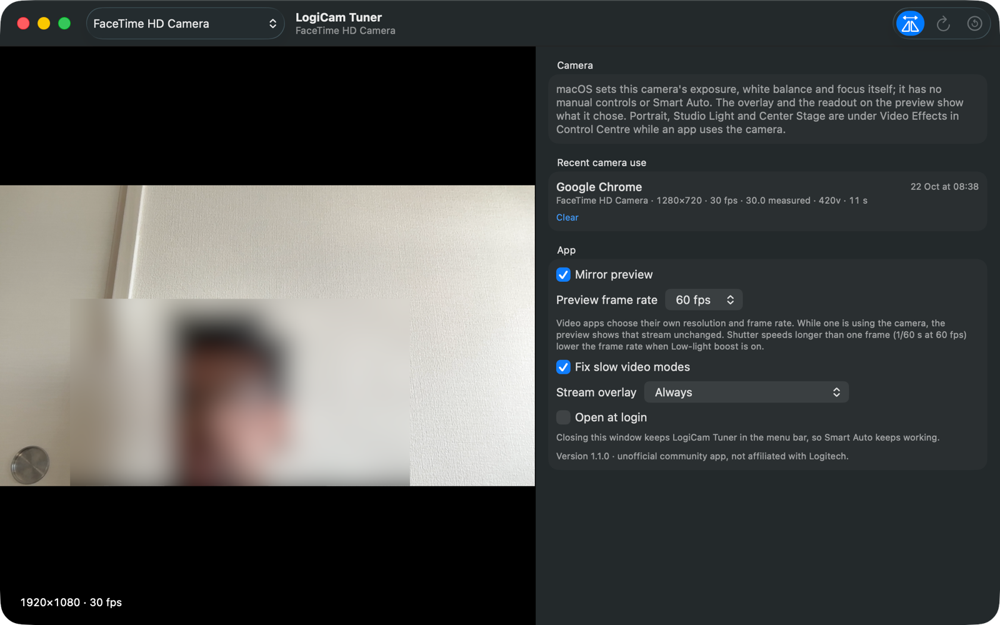

<p align="center">
  
</p>

<h1 align="center">LogiCam Tuner</h1>

<p align="center">
  <strong>An open-source Mac app for the Logitech StreamCam.</strong><br>
  Every setting Logi Options+ offers, smarter auto exposure and white balance, a sharp live preview,
  live stream stats for every call, and a fix for WhatsApp's 5 fps video.
</p>

<p align="center">
  <a href="https://github.com/harsh-gulhane/logicam-tuner/releases/latest"></a>
  <a href="https://github.com/harsh-gulhane/logicam-tuner/actions/workflows/ci.yml"></a>
  
  <a href="LICENSE"></a>
</p>

```sh
brew install --cask harsh-gulhane/tap/logicam-tuner
```

> Unofficial community project, not made, affiliated with or endorsed by Logitech.
> See [Trademarks and disclaimer](#trademarks-and-disclaimer).

## Highlights

- **Every StreamCam setting, instantly.** Shutter speed, ISO, HDR, white balance, focus, zoom,
  anti-flicker and more, applied the moment you move a slider. No Logi Options+ needed.
- **Smart Auto.** Exposure that meters your face and white balance taken from grey surfaces, which
  settle and stay put instead of drifting.
- **Sharp live preview.** Full 1080p at up to 60 fps, right next to the controls.
- **Stream stats for every call.** A floating overlay shows which app is using the camera, the
  resolution and frame rate (optionally the measured one), shutter, ISO and white balance. Drag it
  anywhere, shrink it to one line, or check the same stats from the menu bar.
- **Smooth WhatsApp video.** WhatsApp picks a mode the StreamCam can only run at 5 fps; LogiCam Tuner
  switches it to 1080p at 30 fps automatically.
- **The MacBook camera too.** The overlay and preview follow whichever camera a call uses, including
  the built-in camera and Continuity Camera.
- **Camera on only when needed.** LogiCam Tuner never turns the camera light on by itself, and it comes
  with a `logicam` command-line tool.

## Screenshots

Both screenshots were taken with a MacBook's built-in camera, not a StreamCam. The StreamCam adds the
full controls panel and Smart Auto to the window, and more rows to the overlay (focus, zoom, HDR,
anti-flicker and low-light boost).

### Stream overlay

<p align="center">
  
</p>

A small panel that floats above your call app and never takes focus from it:

- **Which app and which camera.** The app using the camera (found from the apps also using the
  microphone), the camera's name, and how long the stream has run.
- **The real stream.** Resolution, configured frame rate and pixel format, so you can see what Meet,
  WhatsApp or FaceTime really get, and optionally the frame rate actually measured.
- **What the camera chose.** Shutter speed, ISO, colour temperature and light level (on the Mac's own
  camera, while the stream is measured). A StreamCam also shows its focus, zoom, HDR, anti-flicker and
  Smart Auto status.
- **A fix you can see.** When LogiCam Tuner switches an app from a slow mode, such as WhatsApp's 5 fps,
  to 1080p at 30 fps, a "Fixed" row shows what the mode was before.
- **Out of the way.** Drag it anywhere (it remembers where), collapse it to one line with the chevron,
  or hide it with the cross until the camera is next used. It follows you across Spaces and
  full-screen apps. Choose when it appears under **Stream overlay**: Off, While an app uses the camera
  or Always.

### Main window

<p align="center">
  
</p>

A large live preview with the stream's resolution and frame rate, beside the controls. The history
lists each time an app used the camera with its resolution, frame rate and measured frame rate, so
different apps can be compared. The face in the preview is blurred here.

## Install

### Homebrew (recommended)

```sh
brew install --cask harsh-gulhane/tap/logicam-tuner
```

This puts **LogiCam Tuner.app** in Applications and the `logicam` command on your PATH (Homebrew may ask
for your Mac password to copy the app). Update with `brew upgrade --cask logicam-tuner`.

**First launch.** LogiCam Tuner is free and open source, and is not notarized by Apple (that needs a
paid developer account), so macOS blocks it the first time:

1. Open LogiCam Tuner. macOS says it "could not verify" the app; click **Done**.
2. Open **System Settings → Privacy & Security**, scroll down, and click **Open Anyway** next to
   LogiCam Tuner. Confirm with your password.
3. Open the app again. macOS asks for camera access the first time the preview or Smart Auto needs video.

Alternatively, run `xattr -dr com.apple.quarantine "/Applications/LogiCam Tuner.app"` once, which also
clears the block for the `logicam` command. macOS may ask again after an update.

### Download

Download `LogiCam-Tuner-<version>.zip` from the [latest release](https://github.com/harsh-gulhane/logicam-tuner/releases/latest),
unzip it, move **LogiCam Tuner.app** to Applications and follow the first-launch steps above. The
`logicam` command is inside the app at `LogiCam Tuner.app/Contents/MacOS/logicam`.

### Build from source

Requires macOS 14 or later and Swift 5.10+ (Xcode or the Command Line Tools). Apps you build yourself
are not blocked by macOS.

```sh
git clone https://github.com/harsh-gulhane/logicam-tuner.git
cd logicam-tuner
./scripts/build-app.sh          # builds "build/LogiCam Tuner.app" (universal, ad-hoc signed)
open "build/LogiCam Tuner.app"
```

## Why I built this

I recently bought a Logitech StreamCam. The official Logi Options+ app turned out to be too slow and
sluggish to do anything with, and I kept running into problems: video calls on WhatsApp looked choppy,
and the camera's auto mode gave me a dark face and an amber, drifting colour cast.

So I built LogiCam Tuner, a small native Mac app that fixed all of that for me, and made it open source
so anyone with the same camera can use it and contribute to it.

It talks to the camera directly with standard USB Video Class (UVC) control requests, the same
mechanism Logitech's own agent uses. It does not need Logi Options+, Logi Tune, a kernel extension or a
driver. It is built and tested on the StreamCam; other Logitech webcams (Brio, C920, C922…) and most USB
(UVC) webcams should work too, but are untested so far.

The preview and the stream overlay also work with the Mac's built-in camera and Continuity Camera, so
calls are covered when the StreamCam is unplugged or another camera is in use. See
[Other cameras](#other-cameras).

## The app

The main window shows a large live preview beside every control, so each change is visible as you
make it. A readout on the preview shows the current shutter speed, ISO and white balance. The
preview runs at 1080p and 30 or 60 fps (the Mac's built-in camera tops out at 30), shows the measured
frame rate, can be mirrored like a video-call self-view, and stops (camera light off) when the window
is closed, minimised or hidden. The camera picker in the toolbar switches between the StreamCam, the
built-in camera and any other camera.

A menu-bar icon gives quick access to the same controls and to the live stream's stats. Closing the
window keeps LogiCam Tuner running there, so Smart Auto keeps working; quit from the menu-bar icon.

Also: presets per camera (one can apply automatically whenever the camera connects) and Open at login.

## Stream overlay

A small floating panel shows, while any app uses the camera:

- which apps are using it (e.g. "Google Chrome", "FaceTime", "WhatsApp") and which camera,
- the resolution, configured frame rate and pixel format, and the frame rate actually delivered while it
  is measured (see below),
- exposure (mode, shutter, ISO), white balance, focus, brightness, zoom, HDR, anti-flicker and low-light boost,
- Smart Auto's status and how long the camera has been on.

It stays above other windows, appears on every Space and over full-screen apps, and never takes focus
from the call. Drag it anywhere (it remembers the spot), minimise it to a single line with the app,
resolution and frame rate using the chevron, or close it until the camera is next used. Choose Off /
While an app uses the camera / Always in the App section or the menu-bar panel.

Measuring the frame rate a call really gets means LogiCam Tuner has to stream from the camera too, and
macOS then lists it next to the call app in its camera menu (the green camera icon in the menu bar),
with video effects of its own. So it is optional: turn on **Measure frame rate during calls** in the App
section. Smart Auto streams whenever it is on, since it works on the video.

The same stats are in the menu-bar panel, so a quick look needs no overlay at all: its **Live stream**
section shows the one-line summary and folds open to every detail, with a link to bring back a closed
overlay.

The main window keeps a list of recent camera sessions so you can compare how Meet, WhatsApp and
FaceTime configure the camera; `logicam who` shows which cameras are streaming from the terminal.

macOS has no public API that names the apps using a camera. LogiCam Tuner reports the apps that are
capturing the microphone while the camera runs, as call apps do, and otherwise the frontmost app
known to use cameras (marked with "?"). An app using the camera with its microphone fully off is
shown as "Unknown app". Resolution and frame rate are the camera's: apps may scale the picture further.

### Other cameras

The overlay follows whichever camera an app is using: the StreamCam, the Mac's built-in camera or a
Continuity Camera iPhone. When a call uses a different camera, LogiCam Tuner switches to it while it is
in the background, and returns to the camera picked in the window once no app is using a camera. If
apps use several cameras at once, the StreamCam (or another UVC camera) is shown, since Smart Auto runs
there.

macOS adjusts the built-in camera itself and offers no manual controls for it, so there are no sliders
or Smart Auto for it. Instead, the overlay (while the stream is measured) and the preview's readout
show what the camera reports with each frame: shutter speed, ISO, colour temperature and light level,
plus resolution and frame rate. The camera picker in the window's toolbar selects any camera for the
preview.

### Slow video modes (WhatsApp)

Some apps, WhatsApp among them, pick the camera's largest mode. On the StreamCam that is
2304×1296, which the camera can only deliver at 5 fps, so video looks like a slideshow. With
**Fix slow video modes** on (the default), LogiCam Tuner switches the camera to 1080p at 30 fps a couple
of seconds after such an app starts. The camera's mode is shared by every app using it, so the app
receives the smoother video after a pause of about a second. Only a mode with the same picture shape
is used, and LogiCam Tuner tries at most twice per session, so an app that insists on its own mode is
not fought over. The overlay and session history show when this happened.

## Smart Auto

Pick **Smart** for exposure, white balance or both. While any app (Zoom, Meet, FaceTime, OBS…) is
using the camera, LogiCam Tuner looks at a small copy of the video on your Mac and steers the camera's
manual controls itself:

- **Faces first.** Exposure meters detected faces, blended with the scene, so a bright window behind
  you no longer leaves your face dark. A face that detection misses, turning away or looking down at
  notes, keeps counting for several seconds, so exposure does not swing to the window and back.
- **No breathing, no flashing.** Exposure only starts correcting at a clearly visible error (0.25 EV)
  that lasts about a second, and stops close to target; white balance has the same kind of hysteresis.
  Each correction fades in over a fraction of a second rather than landing in one frame, which people on
  the call would see as a flash. The picture settles and stays put.
- **White balance from neutral surfaces.** Only near-grey, well-exposed pixels outside faces count, so a
  coloured shirt or wall does not pull the colour. With too few neutral pixels, it holds the current
  setting instead of guessing.
- **Smooth, clean and flicker-free.** Shutter time is spent first, up to what the frame rate allows,
  then ISO. Only once ISO reaches half your limit may low light lower the frame rate, as far as you
  allow (keep it, or down to 30, 15 or 7.5 fps). Shutter times are snapped to whole mains periods so
  lights do not band. You also choose the highest ISO.
- **Your taste.** Exposure compensation (±2 EV) and a warmth slider.

On a StreamCam in a dim room, the camera's own auto exposure chose 1/25 s at full gain and its auto
white balance left whites amber (5230 K) and drifted for seconds. Smart Auto settled on neutral
whites at about 3400 K within roughly two seconds. Measured with
`logicam auto --watch` on one camera and one room; your results will differ.

With a bright window beside and behind the desk, the stream a call app received from a StreamCam
jumped in brightness between frames 16 times in 90 seconds (by up to 12 levels of 255), as Smart Auto
corrected, overshot and corrected back. With corrections faded in and averaged over about a second, it
changed gradually instead: at most one jump of under 5 levels in each of two 90-second runs. Measured
with a test client in place of the call app.

Smart Auto never turns the camera on by itself: it runs only while another app is streaming (or the
preview is open). Video is analysed in memory and never recorded or sent anywhere. When LogiCam Tuner
quits, the camera's own automatics are switched back on; Smart Auto resumes at the next launch.

## Controls

| Options+ name | LogiCam Tuner | UVC control |
| --- | --- | --- |
| Auto exposure | Exposure mode: Camera / Smart / Manual | exposure mode |
| Shutter speed | Shutter speed (1/30 s …), in stops | exposure time |
| ISO | ISO (gain) | gain |
| Low light compensation | Low-light boost | auto-exposure priority |
| HDR | HDR (backlight compensation) | backlight compensation |
| White balance | Mode: Camera / Smart / Manual, temperature in kelvin | white balance |
| Brightness, contrast, saturation, sharpness | same | processing unit |
| Zoom, pan, tilt | same | camera terminal |
| Focus | Autofocus, focus | camera terminal |
| Anti-flicker | Anti-flicker (50/60 Hz) | power-line frequency |

Controls are discovered from the camera's own descriptor, so only supported controls appear. Gamma,
hue, roll (the StreamCam's portrait/landscape sensor) and others show up when a camera has them.

## CLI

Installed with the app (Homebrew links it as `logicam`). From a source checkout, use
`swift run logicam <command>` or the copy inside the built app.

```sh
logicam version
logicam list
logicam describe
logicam get
logicam set brightness=140 white_balance_auto=off white_balance=4500
logicam set exposure_mode=auto
logicam preset save desk
logicam preset apply desk
logicam reset
logicam auto                    # Smart Auto until Ctrl-C (turns the camera on)
logicam auto exposure --bias -0.3 --min-fps 15
logicam auto --watch            # print measurements only; change nothing
logicam who                     # which cameras are streaming, and the likely apps
```

Use `--camera <index|serial>` when several cameras are attached and `--json` for scripting.

## Notes

- **Logi Options+ / Logi Tune running at the same time.** They can reapply their own saved settings.
  In testing, values LogiCam Tuner set (including Smart Auto's) stayed in place with Options+ running.
- **Detecting other apps.** LogiCam Tuner asks CoreMediaIO whether the camera is streaming. While it is
  streaming itself, for Smart Auto or to measure the frame rate, it pauses for about a second every
  10 seconds to check whether the other app is still there.
  (`AVCaptureDevice.isInUseByAnotherApplication` did not report other apps on macOS 27.)
- **"Disabled by auto mode".** Many cameras (including the StreamCam) report UVC's "disabled by
  automatic mode" flag permanently, so LogiCam Tuner decides whether a control is locked from the current
  value of its auto control instead.
- **Logitech-only features.** Auto-framing (RightSight) and Show Mode use vendor extension units whose
  protocol is not public. LogiCam Tuner lists those units but does not drive them. On the StreamCam, Options+
  offers no other image controls.
- **Diagnostics.** `~/Library/Logs/LogiCamTuner.log` (also `log stream --predicate 'subsystem == "io.github.logicamtuner"'`)
  records when capture starts and stops, each stream's format and measured frame rate, dropped frames,
  restarts after a stalled stream, and session summaries.
- **Preview in the background.** The preview pauses while LogiCam Tuner is not the active app: the call app
  shows its own picture, and LogiCam Tuner can only tell which other apps use the camera while it is not
  streaming itself.

## Tested hardware

| Camera | USB ID | Firmware | Result |
| --- | --- | --- | --- |
| Logitech StreamCam | 046d:0893 | 0x0317 | All 18 advertised standard controls and Smart Auto, macOS 27.0.1 |
| MacBook Pro (M5) built-in camera | — | — | Preview and overlay, with shutter, ISO, colour temperature and light level from frame metadata, macOS 27 |

Reports for other cameras are welcome: include `logicam list` and `logicam describe` output.

## How it was built: a short timeline

Each step started with a problem I hit with the StreamCam and ended with a fix in the app.

1. **Options+ was too slow to use.** Looking at how Logi Options+ works showed that, for the image
   controls, it sends standard UVC control requests to the camera
   ([notes](docs/logitech-options-plus.md)). So LogiCam Tuner does the same, directly and instantly,
   from a menu-bar app and a command-line tool.
2. **Every auto-controlled setting looked locked.** The StreamCam reports UVC's "disabled by auto mode"
   flag all the time, so the app works out what is locked from the auto controls instead.
3. **Auto exposure left my face dark, and auto white balance turned whites amber (5230 K) and kept
   drifting.** Built *Smart Auto*: it exposes for detected faces, takes white balance only from grey
   surfaces, and changes nothing until an error is clearly visible, so the picture settles and stays put.
4. **Exposure kept bouncing between two settings.** Offline tests that simulate the camera's measured
   behaviour caught it: anti-flicker allows only whole 10 ms shutter steps, and the camera's gain is
   weaker than expected. Small corrections now use gain only.
5. **A menu-bar panel wasn't enough to see what a change does.** Added a main window with a large live
   preview beside the controls, then 60 fps support.
6. **The preview was blurry.** The preview was showing the tiny 256-pixel image Smart Auto uses for
   analysis, stretched up. It now draws the full 1080p frames, and the same change halved the app's CPU use.
7. **I wanted to see what each call app actually gets from the camera.** Added a floating overlay with
   live stats: which app is using the camera, resolution, configured and measured fps, format, shutter,
   ISO, white balance and more, plus a history so Meet, WhatsApp and FaceTime can be compared. macOS has
   no public API naming camera users, so the app reports the apps using the microphone at the same time.
8. **The camera stayed on after a call ended.** macOS takes a moment to release the camera, and the app
   mistook its own fading stream for another app. It now waits for the release, and turns the camera off
   within about 10 seconds of a call ending.
9. **WhatsApp video was choppy.** The overlay showed why: WhatsApp picks the camera's highest
   resolution, 2304×1296, which the StreamCam can only deliver at 5 fps. LogiCam Tuner now switches the
   camera to 1080p at 30 fps a moment after WhatsApp starts.
10. **"Auto" anti-flicker failed with an error.** The StreamCam only accepts 50 Hz and 60 Hz, so the app
    now offers only what the camera reports it supports.
11. **Calls on the MacBook's own camera showed nothing.** The app only knew USB cameras. It now
    watches every camera, follows the one in use, and reads the built-in camera's exposure and colour
    from the metadata its image pipeline attaches to every frame, since that camera has no controls.
12. **The overlay wouldn't move, and was always full size.** Its SwiftUI text swallowed the clicks that
    should drag the panel, so it now passes them through to a drag area. It can also be minimised to
    one line, and the menu-bar panel shows the same stats for a quick look.
13. **Calls ran at 15 fps, and exposure kept correcting itself.** The session history showed every
    StreamCam call averaging about 15.8 fps: in a dim room, Smart Auto lengthened frames before using
    any ISO. It now raises ISO first and lowers the frame rate only as a last resort. Exposure also
    jumped whenever face detection missed a turning face for a moment, since metering switched between
    face and scene; a missed face now keeps counting for a few seconds. A stalled stream is restarted,
    and dropped frames are logged.
14. **With a window behind me, the picture flashed on calls.** Measuring the stream a call app receives
    showed each Smart Auto correction landing in a single frame, and often overshooting: the StreamCam's
    brightness moves about twice as far as the exposure model predicts. Each correction now allows for
    that and fades in over several frames; errors are averaged over about a second; faces are measured
    only on the frame they were found in, since a moving head soon leaves its box, which then covers the
    window; and a face missed for up to 8 seconds keeps counting.
15. **Next: a portrait camera for WhatsApp.** The camera only produces landscape video; delivering a
    portrait stream to other apps needs a virtual camera. Research is in progress.

## Development

```sh
swift build
swift run LogiCamKitChecks      # offline checks, including a real StreamCam descriptor fixture
```

The checks run the exposure and white-balance controllers against simulated cameras whose behaviour
(weak gain, exaggerated tone curve, flicker-safe shutter steps) was measured on a real StreamCam.

`docs/logitech-options-plus.md` records how Logi Options+ communicates with the camera.

## Versions

LogiCam Tuner follows [Semantic Versioning](https://semver.org). Each release is tagged `vX.Y.Z`, listed in
[CHANGELOG.md](CHANGELOG.md) and published on the [releases page](https://github.com/harsh-gulhane/logicam-tuner/releases).
Check yours with `logicam version` or in the app's About window.

## Contributing

Issues and pull requests are welcome, especially reports from other cameras. See
[CONTRIBUTING.md](CONTRIBUTING.md).

## Trademarks and disclaimer

LogiCam Tuner is an independent, unofficial community project. It is not made, affiliated with,
sponsored or endorsed by Logitech. Logitech, Logi, StreamCam and Logi Options+ are trademarks of
Logitech, used here only to say which hardware and software this project works with. No Logitech
code, logos or assets are included.

The software is provided as is, without warranty of any kind (see the license). It changes camera
settings only through the standard USB Video Class interface the camera exposes to every app.

## License

[MIT](LICENSE) © 2026 Harsh Gulhane
